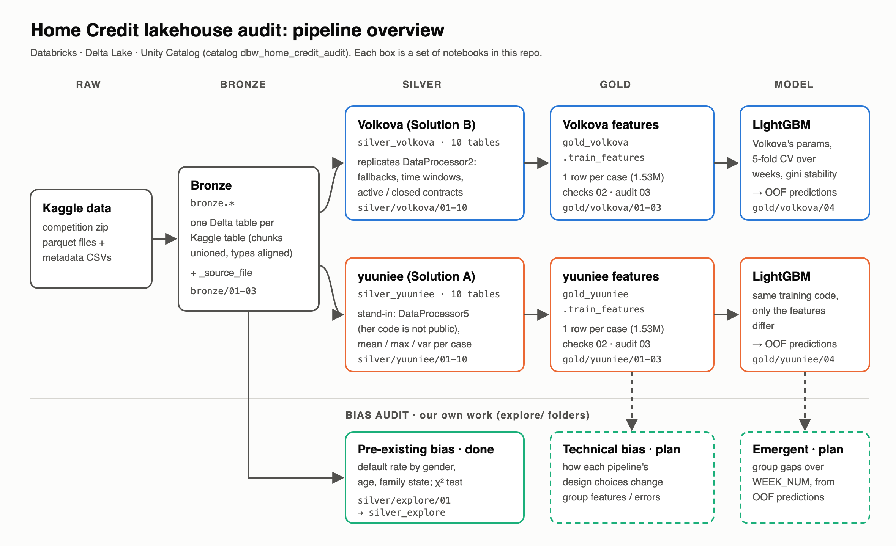

# Home Credit Lakehouse Audit

A bias audit of two automated decision systems (ADSs) for credit risk, built on a
Databricks lakehouse (Delta Lake + Unity Catalog).

**Start here:** [`notebooks/audit_report.ipynb`](notebooks/audit_report.ipynb) walks
through every step of the pipeline and the bias audit, with results and figures.
It runs on Databricks (see [How to run](#how-to-run)).

## What this project does

Two independently developed systems for the
[Home Credit – Credit Risk Model Stability](https://www.kaggle.com/competitions/home-credit-credit-risk-model-stability)
Kaggle competition (2024) predict whether a loan applicant will default:

- **System A**: [yuuniee, 1st place solution](https://www.kaggle.com/competitions/home-credit-credit-risk-model-stability/writeups/yuuniee-1st-place-solution-my-betting-strategy).
  Her feature code is not public, so we use Volkova's simpler `DataProcessor5` as a stand-in.
- **System B**: [Evgeniia Volkova, kagglehomecredit2024](https://github.com/evgeniavolkova/kagglehomecredit2024)
  (commit `d5e228c`). We replicate her `DataProcessor2` feature pipeline and LightGBM.

We rebuild both pipelines on the same data and ask **where along the pipeline bias
against groups of applicants enters**, using the three types of bias from
Friedman & Nissenbaum (1996):

| Bias type | Question | Status |
|---|---|---|
| Pre-existing | Do default rates already differ by gender, age and family state in the raw data? | Done |
| Technical | Do the design choices of each pipeline change how groups are represented or predicted? | Planned |
| Emergent | Do the group gaps change over time (`WEEK_NUM`)? | Planned |

Main pre-existing finding: in the training labels, men default 1.5× as often as
women, applicants aged 18–24 default 3× as often as those 65+, and family state
gaps reach 1.9×. Family state is missing for 52 % of cases.

## Architecture



```
raw     Kaggle zip (parquet + metadata CSVs)
  -> bronze  one Delta table per Kaggle table (chunks unioned, types aligned)
  -> silver  one feature table per source, one row per case, per system
  -> gold    all features joined, one row per case, per system -> LightGBM
```

Unity Catalog schemas in catalog `dbw_home_credit_audit`: `bronze`,
`silver_volkova`, `silver_yuuniee`, `gold_volkova`, `gold_yuuniee`, `silver_explore`.

Feature lineage for both systems:
[`docs/figures/feature_lineage.png`](docs/figures/feature_lineage.png).

## Repo structure

```
notebooks/
  audit_report.ipynb       project report: every step, results, AI disclosure
  bronze/                  raw zip -> bronze Delta tables (01-03)
  silver/
    01_data_finding.py     first look at train_base
    02_data_check.py       null rates of every bronze column
    volkova/               System B silver features (01-10) + FEATURES.md
    yuuniee/               System A silver features (01-10)
    explore/               our audits on bronze (01_pre_existing_bias.py)
  gold/
    volkova/               System B: 01 join, 02 checks, 03 audit, 04 LightGBM
    yuuniee/               System A: same steps
docs/
  figures/                 figures used in the report
  azure-setup-checklist.md workspace / storage setup notes
```

The `volkova/` and `yuuniee/` folders only reproduce what each author did.
Our own audit code is kept separately in `explore/`.

## How to run

1. In Databricks: **Workspace → Create → Git folder**, URL
   `https://github.com/GZ0012/home-credit-lakehouse-audit`.
2. Attach serverless compute or a cluster (DBR 14+).
3. Build the data, in order (skip if the tables already exist):
   1. upload the Kaggle zip to the volume `dbw_home_credit_audit.bronze.raw_uploads`
   2. `notebooks/bronze/01-03`
   3. `notebooks/silver/<system>/01-10`
   4. `notebooks/gold/<system>/01-04`
4. Open `notebooks/audit_report.ipynb` and **Run all**. Only the pre-existing bias
   audit runs (it reads bronze only, about 1–3 minutes).

`04_train_lgbm.py` needs `lightgbm` 4.x (add it in the Environment panel on
serverless, or as a cluster library).

## Sources

- Data: Home Credit Group, *Home Credit – Credit Risk Model Stability*, Kaggle 2024.
- System A: yuuniee, *1st place solution*, Kaggle write-up.
- System B: E. Volkova, *kagglehomecredit2024*, GitHub, commit `d5e228c`.
- B. Friedman and H. Nissenbaum, "Bias in computer systems", *ACM TOIS* 14(3), 1996.

Each script cites the author code it follows in its docstring. AI use is disclosed
in section 9 of the report notebook.
